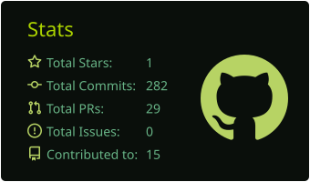
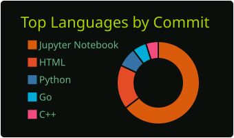

  

<h1 align="center">👨‍💻 Aleksandr (@Gooddru)</h1>

  

## 🛠 Skills

  
  
  
  
  
  
  
  
  
  
  

## 🚀 Projects

- 🕸️ [**AlgoNode**](https://github.com/Gooddru/AlgoNode) — A high-performance microservice engine for solving complex graph theoretical problems (such as cycle detection, critical path calculation, and dynamic routing). Built with a **Go** API gateway for fast request handling, a **Python** worker for heavy algorithmic computations, and **PostgreSQL** for state persistence. Fully Dockerized.
- 🎭 [**SentimentAnalyzer Web**](https://github.com/Gooddru/Sentiment-analyzer) — A fast web application built with **Python (Streamlit)** and **Hugging Face** to analyze the emotional tone of text in real-time. Dockerized for easy deployment.
- ⌨️ [**TranslateKeyboard**](https://github.com/Gooddru/translatekeyboard) — A handy utility for on-the-fly text translation and layout correction directly from keyboard input. Speeds up typing and cross-language communication without switching context.
- 🧮 [**CSRMatrix**](https://github.com/Gooddru/CSRMatrix) — A high-performance implementation for manipulating and performing mathematical operations on Compressed Sparse Row (CSR) matrices. Optimized for memory efficiency and speed in linear algebra and graph algorithms.
- 🎓 [**University Labs**](https://github.com/Gooddru/University_labs) — A curated collection of academic laboratory works and assignments completed during my studies at ITMO University. Demonstrates foundational computer science concepts, practical coding exercises, and various technical implementations across university coursework.

## 📬 Contact me

- **Telegram (preferred):** [@Gooddru](https://t.me/gooddru)
- **Email:** [trollbabich1@mail.ru](mailto:trollbabich1@mail.ru) | [altx2005@gmail.com](mailto:altx2005@gmail.com)
- **VK:** [@niggggadie](https://vk.ru/niggggadie)

## 📊 Stats

  
  

  

   
  

  

